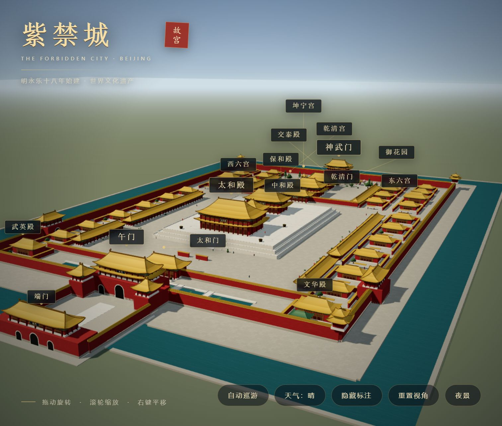
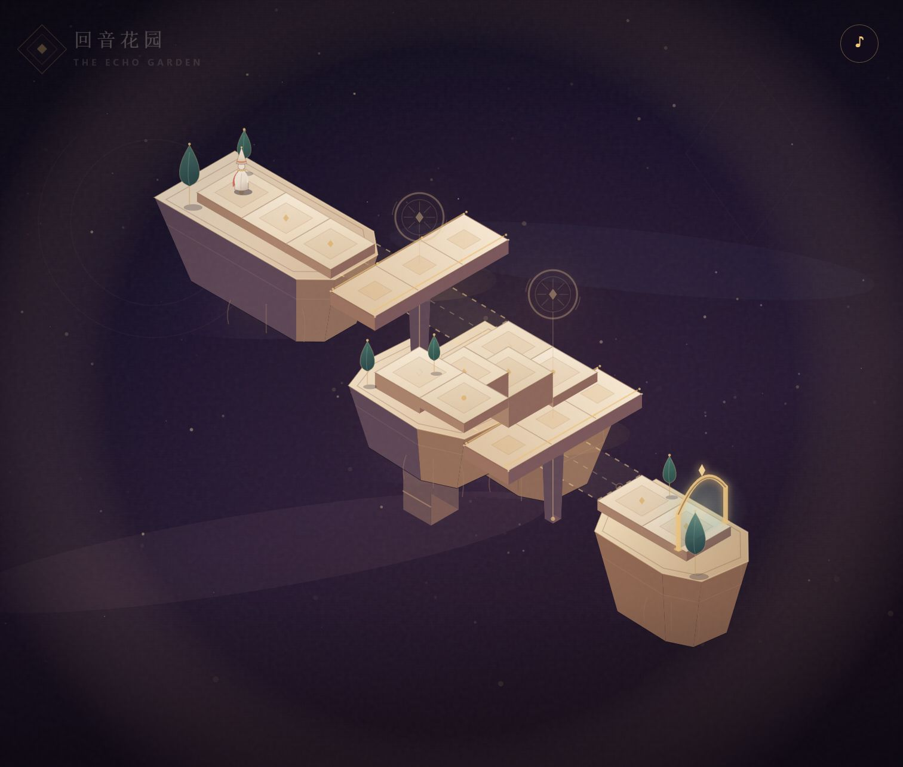
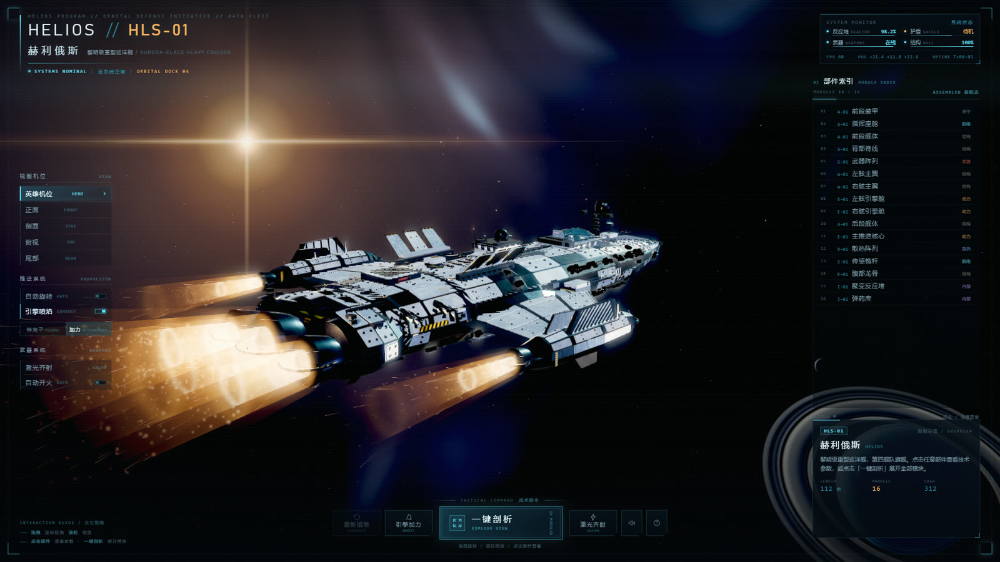
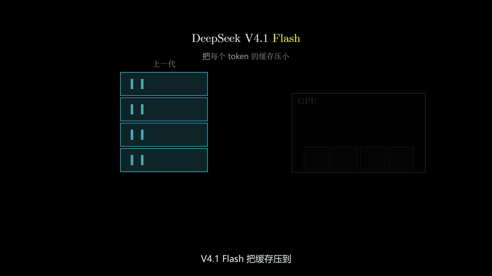
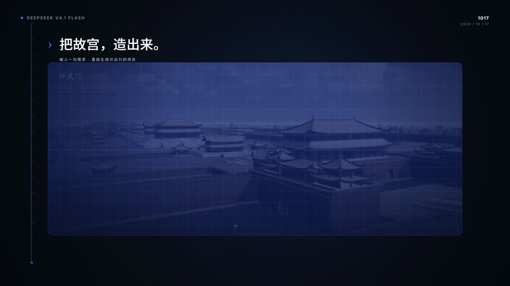
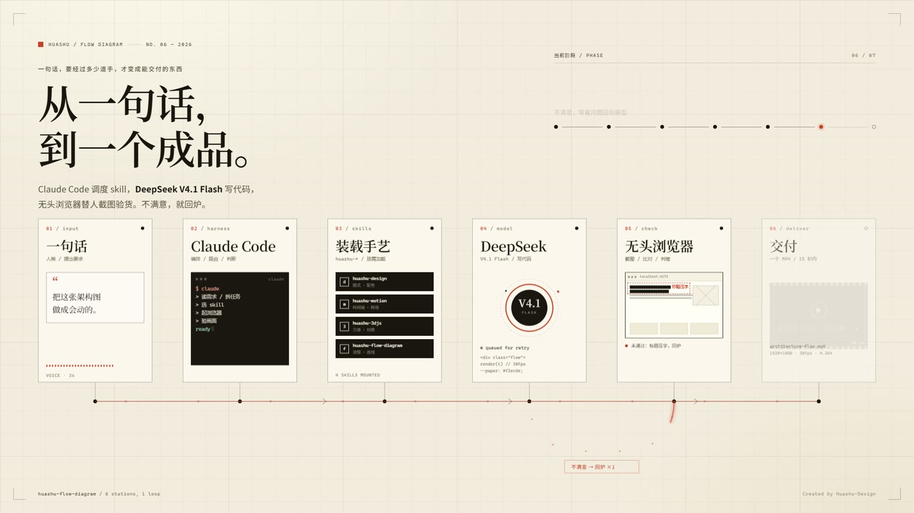

<header class="ai-page-head">

AI Channel / 生成实验

<h2 class="ai-page-title">从紫禁城到深空</h2>

一次关于 3D、动效与交互的生成实验。所有作品均由 OpenCode + DeepSeek V4.1 Flash 在本机完成生成、渲染与验收。

</header>

<b>06</b>Works

<b>03</b>Videos

<b>03</b>Interactive

<b>89<small>s</small></b>Total film

<article class="ai-card wide" id="forbidden-city">
<figure class="ai-cover">

01 / 06
WebGL
</figure>

<h3>紫禁城 · 故宫 3D 网页</h3>

单文件 Three.js 场景：鼠标自由旋转缩放，晴 / 雨 / 雪 / 夜景四种天气，11 个悬浮建筑名，19 个走动人物，屋顶、斗拱与窗棂全部程序化生成。按故宫中轴布局重建，需要联网加载 Three.js CDN。

Three.js
单文件

<a class="mini-btn mini-btn--primary" href="data/demos/forbidden-city.html" target="_blank" rel="noopener">打开页面 ↗</a>
<button type="button" class="mini-btn ai-prompt-toggle" data-prompt-toggle="prompt-forbidden-city" aria-expanded="false" aria-controls="prompt-forbidden-city"><i class="fas fa-chevron-down"></i> 查看提示词</button>

制作单文件 Three.js 故宫 3D 网页，支持鼠标旋转与缩放；后续迭代包括修正比例、悬浮建筑名、天气与人物、按平面图重排布局。

</article>

<article class="ai-card" id="monument">
<figure class="ai-cover">

02 / 06
Game
</figure>

<h3>回音花园 · 视错觉解谜关卡</h3>

纪念碑谷风格的等距小游戏：点击石板行走，转动金色轮盘接通断桥，两座桥归位后走进拱门通关。单文件、无外部依赖，离线可玩。

Canvas
离线

<a class="mini-btn mini-btn--primary" href="data/demos/monument-valley.html" target="_blank" rel="noopener">打开页面 ↗</a>
<button type="button" class="mini-btn ai-prompt-toggle" data-prompt-toggle="prompt-monument" aria-expanded="false" aria-controls="prompt-monument"><i class="fas fa-chevron-down"></i> 查看提示词</button>

制作单文件《纪念碑谷》风格等距视错觉解谜关卡：旋转机关接通道路，点击行走，到达终点通关；完成后验证可通关。

</article>

<article class="ai-card" id="helios">
<figure class="ai-cover">

03 / 06
WebGL
</figure>

<h3>HELIOS HLS-01 飞船页面</h3>

完全离线的单文件 Three.js 展示页：16 个模块一键剖析、双模式引擎喷焰、激光齐射、五组机位与程序化深空星云。

Three.js
离线

<a class="mini-btn mini-btn--primary" href="data/demos/helios.html" target="_blank" rel="noopener">打开页面 ↗</a>
<button type="button" class="mini-btn ai-prompt-toggle" data-prompt-toggle="prompt-helios" aria-expanded="false" aria-controls="prompt-helios"><i class="fas fa-chevron-down"></i> 查看提示词</button>

改进现有 3D 飞船页面的清晰度、亮度与材质，修正鼠标拾取偏移与标签跟随；后续要求去除锈迹、增强光效并调整开场机位。

</article>

<article class="ai-card wide" id="kv-cache">
<figure class="ai-cover">

04 / 06
Video
</figure>

<h3>KV cache 45 秒解说动画</h3>

纯黑底、3b1b / manim 语法，10 个镜头。讲清 AI agent 为什么把大量成本花在 KV cache 上，以及缓存压到上一代 1/4 显存、1/8 硬盘意味着什么。中文口播 + 烧录字幕。

3b1b
45s

<button type="button" class="mini-btn mini-btn--primary" data-video="data/videos/kv-cache.mp4" data-video-title="KV cache · 45s"><i class="fas fa-play"></i> 播放</button>
<a class="mini-btn" href="data/videos/kv-cache.zh.srt" download>字幕 .srt</a>
<button type="button" class="mini-btn ai-prompt-toggle" data-prompt-toggle="prompt-kv-cache" aria-expanded="false" aria-controls="prompt-kv-cache"><i class="fas fa-chevron-down"></i> 查看提示词</button>

制作 45 秒 3b1b 风格解说动画，说明 AI agent 的 KV cache 成本，以及 DeepSeek V4.1 Flash 将缓存压缩至上一代 1/4 显存、1/8 硬盘的影响；包含中文口播与字幕，导出 MP4。

</article>

<article class="ai-card" id="promo">
<figure class="ai-cover">

05 / 06
Video
</figure>

<h3>DeepSeek 1017 发布宣传片</h3>

30 秒、16:9 的发布片。四段官方演示素材 + 基准数字与性能–费用图，Chrome 逐帧渲染；音乐与音效由时间线生成，无口播。

huashu
30s

<button type="button" class="mini-btn mini-btn--primary" data-video="data/videos/deepseek-1017-promo.mp4" data-video-title="DeepSeek 1017 · 30s"><i class="fas fa-play"></i> 播放</button>
<a class="mini-btn" href="data/deepseek-1017.jpg" target="_blank" rel="noopener">海报</a>
<button type="button" class="mini-btn ai-prompt-toggle" data-prompt-toggle="prompt-promo" aria-expanded="false" aria-controls="prompt-promo"><i class="fas fa-chevron-down"></i> 查看提示词</button>

制作 DeepSeek V4.1 Flash 1017 版本发布宣传片，使用 huashu-motion；独立调研素材，不参考已有成片。

</article>

<article class="ai-card" id="arch">
<figure class="ai-cover">

06 / 06
Video
</figure>

<h3>会流动的 harness 架构图</h3>

14 秒工程制图风流程图：一句话 → Claude Code → 装载 skill → 模型写代码 → 无头浏览器自检 → 回炉 → 交付。纯 <code>render(t)</code> 驱动，逐帧导出 420 帧。

Flow
14s

<button type="button" class="mini-btn mini-btn--primary" data-video="data/videos/architecture-flow.mp4" data-video-title="Harness Flow · 14s"><i class="fas fa-play"></i> 播放</button>
<a class="mini-btn" href="data/demos/architecture-flow.html" target="_blank" rel="noopener">源页面 ↗</a>
<button type="button" class="mini-btn ai-prompt-toggle" data-prompt-toggle="prompt-arch" aria-expanded="false" aria-controls="prompt-arch"><i class="fas fa-chevron-down"></i> 查看提示词</button>

制作会流动的 harness 架构图：一句话 → Claude Code → 加载 skill → 模型写代码 → 无头浏览器自检 → 回炉 → 交付；导出 15 秒以内 MP4。

</article>

全部作品由 OpenCode + DeepSeek V4.1 Flash 生成。点击每件作品的「查看提示词」可看原始提示词。

